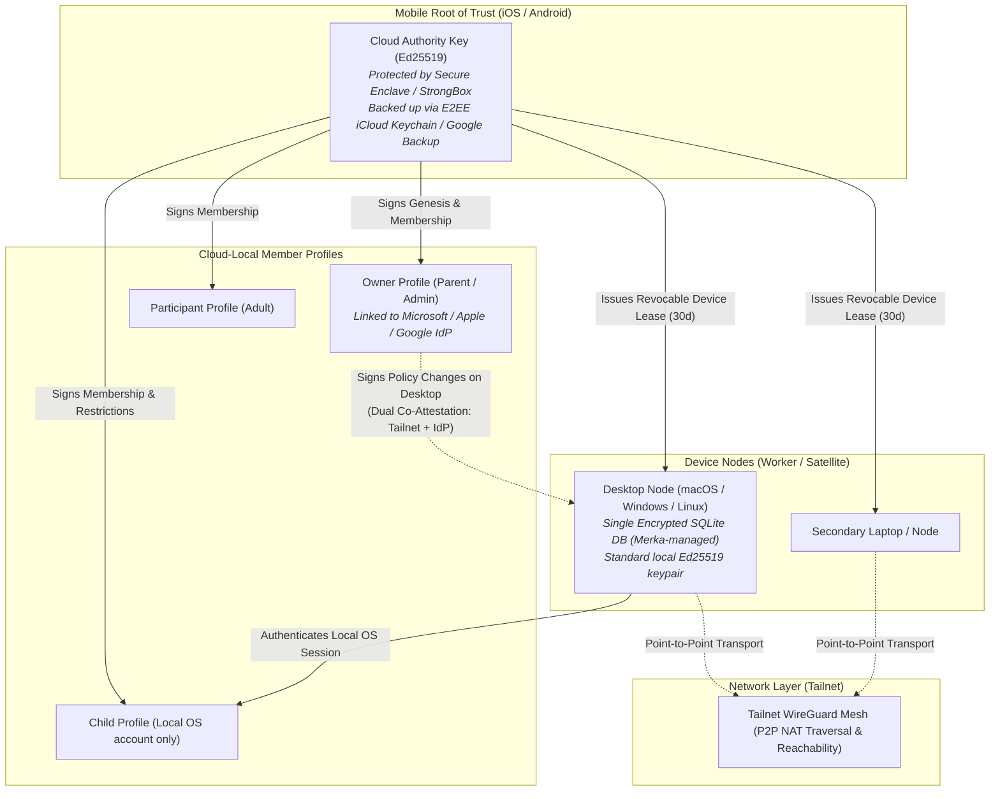
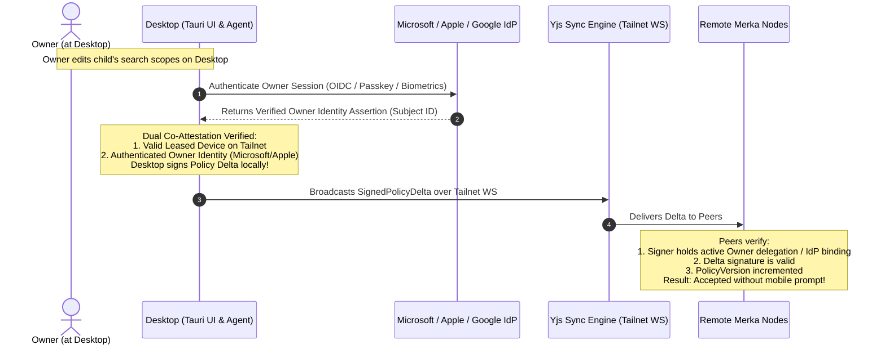

# Merka.cloud Security Architecture

- **Status:** Approved Core Design; implementation in progress.
- **Scope:** Cloud creation, mobile root of trust, leased device credentials, self-contained encrypted SQLite desktop storage, tamper-proof cloud-local member profiles (including local-only/child accounts), dual co-attested policy synchronization over CRDT (no mobile prompt needed for desktop admins), recovery scenarios, and Tailnet network boundaries.

This document establishes the security architecture for Merka.cloud. The portal is a public cryptographic discovery directory, not an account provider: cloud creation and administration do not require signing in to merka.cloud. Tailnet provides the encrypted network transport and peer reachability layer, while each Merka cloud defines its own cryptographic trust chain, member profiles, device enrollment leases, and data authorization.

---

## 1. Security Principles

- **Intelligent overlay, not file encryptor:** Data files remain in their native locations on their host devices and are governed by native OS filesystem permissions and access control lists. Merka does not replicate or re-encrypt user data files; it operates as an intelligent indexing, metadata, and capability overlay.
- **Mobile device as root of trust:** Cloud creation and top-level administrative authority are anchored in iOS and Android devices, leveraging built-in hardware Secure Enclaves / StrongBox with biometric authorization (FaceID, TouchID, fingerprint).
- **Leased device credentials (TPM-free):** Desktops and worker nodes do not require hardware TPMs or OS-native keychains. They generate local standard keypairs and receive time-bound, revocable **Device Leases** signed by the mobile Cloud Authority. If a device is lost or compromised, its lease can be revoked instantly or left to expire.
- **Application-managed encrypted storage on desktop:** Desktop nodes do not assume the presence or reliability of OS-native credential vaults (macOS Keychain, Windows DPAPI, or Linux Secret Service), ensuring compatibility across older OSes and minimal Linux distros. Instead, Merka manages its own encrypted storage using a single encrypted SQLite database (e.g., SQLCipher / AES-256-GCM) for sensitive configuration, credentials, and index caches.
- **Low-friction desktop administration (Dual Co-Attestation):** Once a desktop is enrolled, an Owner does not need to pull out their phone to approve everyday security changes (such as tweaking folder permissions or a child's search boundaries). If the desktop is authenticated on the Tailnet and the local user is signed into their previously linked Microsoft, Apple, or Google account, the desktop is authorized to sign and broadcast policy changes directly.
- **Cryptographic tamper-proofing of profiles:** Local databases and CRDT documents are treated as untrusted caches. All profile roles, capabilities, and restrictions are cryptographically signed. A local user (even with OS admin access) cannot elevate permissions by tampering with SQLite or local files.
- **Signed policy synchronization:** Profile and policy changes propagate across nodes over Tailnet using Yjs CRDTs, but updates are committed to the local authorization engine only after strict cryptographic signature and policy-version verification.
- **Flexible profile mapping (including local-only accounts):** Merka profiles can link to external identities (Apple, Google, Microsoft) or exist purely as local OS accounts (e.g., a child profile on a shared desktop without an email or Tailnet identity).

---

## 2. Identity & Trust Model



### 2.1. Trust Hierarchy Summary

| Identity | Security Primitive | Where Stored | Role & Authority |
| --- | --- | --- | --- |
| **Cloud Authority (Anchor)** | Ed25519 Signing Key (RFC 7638 SHA-256 JWK thumbprint = `cloudId`) | Mobile Hardware Enclave (iOS SEP / Android StrongBox); synced via E2EE cloud backup | Signs genesis, approves device leases, handles disaster recovery, publishes discovery records to portal |
| **Member Profile** | Cryptographically signed profile assertion & public key | Synced across nodes via Yjs CRDT; verified locally | Represents a human user (Owner, Participant). May link to Apple/Google/MS IdP or be local-only |
| **Device Node Key** | Ed25519 Keypair | Stored inside Merka's encrypted SQLite database on desktop | Authenticates node-to-node RPC and queries. Held by desktop Tauri/Bun processes |
| **Device Lease** | Compact signed JWS / token | Stored inside encrypted SQLite database | Time-limited certificate issued by Cloud Authority binding Device Key to Cloud and permissions |
| **Tailnet Identity** | Tailscale machine key & user identity | Managed by Tailscale daemon | Network routing, WireGuard transport encryption, and peer reachability |

---

## 3. Leased Device Credentials & Desktop Storage

Desktops (macOS, Windows, Linux) vary widely in their hardware security capabilities. DIY PCs and Linux servers frequently lack standardized, accessible TPM APIs or functional OS keychains.

### 3.1. Single Encrypted SQLite Store (Merka-Managed)
Rather than relying on brittle OS-native credential vaults, Merka on desktop maintains a **single encrypted SQLite database** (e.g., SQLCipher / AES-256-GCM envelope):
- **Contents:** Device keys, active leases, signed profile assertions, Yjs sync state, vector embeddings, and local metadata caches.
- **Keying & Unlock:**
  - During initial device enrollment, the mobile pairing exchange generates and delivers a Database Encryption Key (DEK).
  - The desktop can protect this DEK in memory during active daemon lifecycle, and persist it locally sealed with a lightweight user PIN or session passkey.
  - Zero dependencies on external OS services like `libsecret`, DPAPI, or TPM chips.

### 3.2. Device Enrollment
1. **Key Generation:** When `apps/desktop` is installed, it initializes its encrypted SQLite database and generates a standard local Ed25519 keypair.
2. **Pairing Request:** The desktop displays an enrollment QR code containing its public key, local device name, and Tailnet node identifier.
3. **Approval & Leasing:** The Owner scans the QR code using the Merka mobile app. After biometric confirmation (FaceID/TouchID), the mobile Cloud Authority signs a **Device Lease**:
   ```json
   {
     "type": "merka.device.lease.v1",
     "cloudId": "urn:merka:cloud:...",
     "devicePublicKey": "...",
     "nodeName": "Living-Room-PC",
     "tailnetNodeId": "node-xyz",
     "issuedAt": 1731110000,
     "expiresAt": 1733702000,
     "capabilities": ["index.read", "search.execute", "inference.host"]
   }
   ```
4. **Lease Delivery:** The signed lease and initial cloud configuration are returned to the desktop and stored in its encrypted SQLite database.

### 3.3. Lease Renewal & Revocation
- **Silent Renewal:** As long as the mobile device and desktop communicate over the Tailnet during everyday use, the mobile app silently issues a renewed lease before expiration.
- **Revocation:** If a laptop is lost, sold, or compromised:
  1. The Owner taps **"Revoke Device"** on their mobile app.
  2. The mobile app publishes a revocation entry to the cloud's signed Certificate Revocation List (CRL) / policy log synced via CRDT.
  3. Peer nodes immediately drop connections and reject requests bearing the revoked device key.
  4. Even if the revoked device is offline and never receives the revocation log, its cached lease expires automatically at `expiresAt`.

---

## 4. Member Profiles, Local Accounts & Tamper-Proofing

Merka separates the **device lease** (which trusts the physical machine) from the **member profile** (which governs who is acting).

### 4.1. Account Types Supported
1. **Federated / Social Identity Profiles:**
   - Member profiles linked to an Apple ID, Google Account, or Microsoft Account.
   - Useful for adult family members who have their own personal devices and email addresses.
2. **Local-Only OS Profiles (e.g., Children, Family Shared Accounts):**
   - A member profile with no email, no cloud account, and no Tailnet identity.
   - Example: A child with a local login account on a family macOS or Windows computer.
   - **How Trust is Established:**
     - The parent authorizes the desktop computer via a Device Lease.
     - Within the desktop app, the parent provisions a child profile mapped to the local OS user session (POSIX UID on macOS/Linux or Windows SID).
     - Local Bun agent processes run under the child's OS account, inheriting normal OS file isolation.
     - The child's agent can participate in cloud queries (within parent-configured bounds) using capabilities signed by the desktop's leased device key.

### 4.2. Tamper-Proofing Against Local Privilege Escalation
On a shared desktop, a technically adept child or local user might attempt to elevate their privileges by modifying SQLite database rows or editing cached JSON/CRDT files. Merka prevents this through two defense layers:

1. **Database Encryption at Rest:**
   - The Merka SQLite store is encrypted at rest using AES-256. Unprivileged OS accounts on the machine cannot read or write the database file directly.
2. **Cryptographic Signatures as Source of Truth:**
   - Even if a clever user bypasses filesystem protections and manipulates the database rows directly (e.g., setting `"role": "Owner"`), **the modification is completely useless**.
   - Every profile role, capability grant, and content boundary is encapsulated in an immutable **Profile Assertion** signed by an authorized key:
     ```json
     {
       "type": "merka.profile.assertion.v1",
       "cloudId": "urn:merka:cloud:...",
       "profileId": "profile-child-1",
       "role": "Participant",
       "restrictions": {
         "allowedSearchScopes": ["library:school", "folder:family-photos"],
         "maxInferenceTokensPerHour": 5000
       },
       "policyVersion": 4,
       "signer": "authorized-signer-pubkey",
       "signature": "..."
     }
     ```
   - **Verification on Every Query:** When a child's agent requests a Scatter-Gather search or file access, the responding node evaluates the cryptographically signed assertion. If the role or search scopes were altered without a valid signature, the signature check fails immediately, and the request is rejected with `InvalidSignatureError`.

---

## 5. Profile Synchronization Across Nodes & Frictionless Desktop Administration

A major usability goal is to avoid requiring the Owner to pull out their mobile phone to approve every desktop change (e.g., adjusting a folder grant or child search restriction).



### 5.1. Dual Co-Attestation: Desktop Administration Without Mobile Prompts
Instead of requiring a mobile push confirmation for routine administrative tasks, Merka allows an enrolled desktop to sign and broadcast **Signed Policy Deltas** directly when **Dual Co-Attestation** is satisfied:

1. **Hardware / Node Factor (Enrolled Tailnet Device):**
   - The desktop possesses a valid, unexpired **Device Lease** and is communicating over the authenticated Tailnet mesh.
2. **User Identity Factor (Linked Microsoft, Apple, or Google Account):**
   - The local user is actively authenticated against the external identity (e.g., Microsoft Account, Apple ID, or Google Account) that was previously bound to the Owner profile during cloud setup.
   - The desktop app uses OIDC / WebAuthn passkey to confirm the active user matches the registered Owner identity.

**How Peers Validate the Change:**
- When the desktop broadcasts a `SignedPolicyDelta`, it attaches:
  - The new policy delta (e.g., `UPDATE_RESTRICTIONS` for `child-1`).
  - The desktop's valid Device Lease.
  - The signed delegation proof verifying the Owner's authenticated identity.
- Receiving nodes verify:
  1. The device lease is active and not on the CRL.
  2. The delta was authorized by the verified Owner identity.
  3. `policyVersion` is strictly greater than the previous known version.
- **Result:** The security change takes effect across the entire Merka cloud instantaneously with zero mobile friction.

### 5.2. When Is Mobile Authorization Actually Needed?
Mobile biometric approval is reserved strictly for high-impact, irreversible lifecycle events:
- **Cloud Genesis:** Creating the cloud and initial Cloud Authority key.
- **Device Enrollment:** Scanning a QR code to admit a new physical computer or phone.
- **Authority Handover:** Transferring cloud root ownership to a new phone (Scenario A).
- **Disaster Recovery:** Restoring from an OS cloud backup after phone loss (Scenario B).

---

## 6. Mobile Key Custody & Device Recovery

Because the mobile device serves as the primary Cloud Authority, handling device upgrades (Scenario A) and device loss (Scenario B) is essential.

### 6.1. Hardware Enclave Storage
- **iOS:** Private keys are created inside the Apple Secure Enclave (`kSecAccessControlBiometryAny` or `kSecAttrAccessibleAfterFirstUnlockThisDeviceOnly`) and managed via the iOS Keychain.
- **Android:** Private keys are backed by the Android Keystore with StrongBox Keymaster hardware backing whenever supported by the SoC.

### 6.2. Scenario A: Planned Device Upgrade (Phone A $\to$ Phone B)
When the user purchases a new phone and both the old and new devices are operational:
1. **Key Generation:** Merka is installed on Phone B, generating a new hardware-enclave-backed keypair (`PhoneB_PubKey`).
2. **Pairing Session:** Phone B generates a high-entropy ephemeral pairing QR code.
3. **Biometric Authorization:** Phone A scans the QR code. The user authenticates via FaceID/fingerprint.
4. **Handover Certificate:** Phone A signs a **Cloud Authority Handover Record**:
   ```json
   {
     "type": "merka.authority.handover.v1",
     "cloudId": "urn:merka:cloud:...",
     "oldAuthority": "PhoneA_PubKey",
     "newAuthority": "PhoneB_PubKey",
     "transferredAt": 1731110000,
     "signature": "..."
   }
   ```
5. **Propagation & Portal Update:**
   - Phone B broadcasts the handover record to all enrolled nodes over the Tailnet mesh.
   - Phone B publishes an authenticated update to the public discovery portal signed by the handover chain.
   - Phone A wipes its authority keys and transitions to an ordinary participant or is decommissioned.

### 6.3. Scenario B: Sudden Loss / Destruction Recovery
When Phone A is permanently lost, stolen, or destroyed:
- **OS-Managed End-to-End Encrypted Cloud Backup:**
  - The Cloud Authority seed/master key is backed up via platform-native end-to-end encrypted keychains:
    - **iOS:** iCloud Keychain (end-to-end encrypted with Apple Cloud Key Vault HSM escrow and device passcode).
    - **Android:** Android Backup / Google Cloud Keystore (end-to-end encrypted with lock screen PIN/passcode).
- **Restore Sequence:**
  1. The user activates their replacement phone with their Apple ID or Google Account.
  2. The OS restores the app's encrypted keychain payload upon successful entry of the device passcode/biometrics.
  3. Merka launches on the new phone, detects the restored master authority material, re-initializes it inside the new phone's hardware Secure Enclave, and confirms the `cloudId`.
  4. The user opens the device management list and clicks **"Revoke Lost Phone"**, issuing a signed revocation entry across the Tailnet to invalidate any leases or cached access on the lost physical device.

---

## 7. Tailnet Role & Separation of Concerns

Tailnet provides essential networking infrastructure, but is strictly isolated from application authorization:

```mermaid
graph LR
    subgraph NetworkLayer["Transport Layer (Tailnet / WireGuard)"]
        direction TB
        NL1["NAT Traversal & Hole Punching"]
        NL2["Point-to-Point WireGuard Encryption"]
        NL3["Network Peer Reachability & Stable IPs"]
        NL4["tailscale whois (Machine / Node verification)"]
    end

    subgraph AppLayer["Application Layer (Merka Trust Chain)"]
        direction TB
        AL1["Cloud Authority Signing & Leases"]
        AL2["Member Profiles (Parents, Kids, Local Users)"]
        AL3["CRDT State Sync & Vector Query Authorization"]
        AL4["Local OS File Access (Native Permissions)"]
    end

    NetworkLayer -->|"Carries Encrypted Packets"| AppLayer
```



- **WireGuard handles transit security:** Prevents eavesdropping, tampering, and public IP exposure across the WAN.
- **Merka handles data authorization:** Prevents unauthorized queries, enforces member role grants, isolates child profiles, and ensures revoked devices are blocked even if they remain connected to the Tailnet.

---

## 8. Open Decisions Before Implementation

1. **Lease Format Specification:** Finalize the compact JWS claims and schema for device leases in `@merka/core`.
2. **Renewal Interval:** Determine default lease duration (e.g., 14 days vs. 30 days) and silent renewal frequency over Tailnet.
3. **Local Child Consent & Audit:** Define the UI flow in Tauri 2 for parents to review and set search boundaries for local-only child accounts on shared machines.
4. **Portal Discovery Record Rotation:** Specify the signed transition record format when the Cloud Authority is rotated following a device handover.
