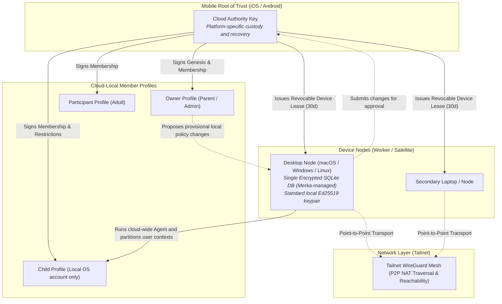

# Merka.cloud Security Architecture

- **Status:** Core trust decisions adopted below; wire-format and implementation details remain in progress.
- **Scope:** Cloud creation, mobile root of trust, leased device credentials, encrypted desktop storage, signed cloud-local member profiles, provisional desktop policy changes and mobile-approved synchronization, device removal and recovery, and Tailnet network boundaries.

This document establishes the security architecture for Merka.cloud. The portal is a public cryptographic discovery directory, not an account provider: cloud creation and administration do not require signing in to merka.cloud. Tailnet provides the encrypted network transport and peer reachability layer, while each Merka cloud defines its own cryptographic trust chain, member profiles, device enrollment leases, and data authorization.

---

## 1. Security Principles

- **Intelligent overlay, not file encryptor:** Data files remain in their native locations on their host devices and are governed by native OS filesystem permissions and access control lists. Merka does not replicate or re-encrypt user data files; it operates as an intelligent indexing, metadata, and capability overlay.
- **Mobile device as root of trust:** Cloud creation and top-level administrative authority are anchored in iOS and Android devices, with hardware-backed keys and user authentication where supported and validated.
- **Leased device credentials (TPM-free):** Desktops and worker nodes do not require hardware TPMs or OS-native keychains. They generate local standard keypairs and receive time-bound, revocable **Device Leases** signed by the mobile Cloud Authority. Revocation is effective on each peer when that peer receives and verifies it; leases also expire.
- **Physical-device trust boundary:** Once a device is cryptographically proven to belong to a Merka cloud, Merka trusts that device to operate on behalf of the cloud and to allow any person with physical access to prompt the Agent and review information prepared for presentation on that device. This is not authorization to access an unrelated, private account on another device; it is authorization to use the trusted local Agent and only the user-specific contexts that Merka has assigned to the user/device relationship.
- **Always-on local operation:** Merka agents are expected to collect, index, reason about, and prepare output without waiting for a human session. Background operation is authorized by the device lease and the locally executed cloud policy, not by continuous phone approval or presence.
- **Two information scopes:** Cloud-wide data and policy are available according to the device's cloud membership. User-specific data, memory, drafts, and prepared reviews are separated by user/profile context and must not be exposed to a different user context. Cloud-wide derived output must not silently copy private user context into a shared artifact.
- **Application-managed encrypted storage on desktop:** Desktop nodes do not assume the presence or reliability of OS-native credential vaults (macOS Keychain, Windows DPAPI, or Linux Secret Service), ensuring compatibility across older OSes and minimal Linux distros. Instead, Merka manages its own encrypted storage using a single encrypted SQLite database (e.g., SQLCipher / AES-256-GCM) for sensitive configuration, credentials, and index caches.
- **Local-first desktop administration:** Any person with physical access may use the trusted Agent. Administrative security changes require an authorized local/cloud policy administrator and may be made provisionally on an enrolled desktop without waiting for the root phone. The change applies only to activity on that desktop; cloud-wide policy requires explicit authority approval.
- **Signed profiles and trust boundaries:** Local databases and CRDT documents are untrusted caches. Cloud-wide profile roles, capabilities, and restrictions require authorized signatures. Signatures protect honest peers from accepting tampered assertions, but cannot secure a compromised device against its own administrator.
- **Signed policy synchronization:** Yjs carries proposals and approved policy records, but is not an authorization authority. Each node verifies the root-phone approval and its policy history before applying a cloud-wide change.
- **Simple local profile mapping:** Merka profiles are represented within the cloud. Each OS account receives a Merka member identifier that is authorized against a cloud profile; no external account identity is required.

---

## 2. Identity & Trust Model



### 2.1. Trust Hierarchy Summary

| Identity | Security Primitive | Where Stored | Role & Authority |
| --- | --- | --- | --- |
| **Cloud Authority (Anchor)** | Authority signing key; `cloudId` identifies the genesis authority | Mobile key custody and recovery mechanism to be validated per platform | Signs genesis, approves cloud-wide policy and device leases, handles recovery, publishes discovery records |
| **Member Profile** | Cryptographically signed profile assertion | Synced across nodes via Yjs CRDT; verified locally | Represents a family member or cloud-local user context. It partitions user-specific memory and prepared results |
| **Device Node Key** | Ed25519 Keypair | Stored inside Merka's encrypted SQLite database on desktop | Authenticates node-to-node RPC and queries. Held by desktop Tauri/Bun processes |
| **Device Lease** | COSE_Sign1/CWT credential | Stored inside encrypted SQLite database | Time-limited certificate issued by Cloud Authority binding Device Key to Cloud and permissions |
| **Tailnet Identity** | Tailscale machine key & user identity | Managed by Tailscale daemon | Network routing, WireGuard transport encryption, and peer reachability |

---

## 3. Leased Device Credentials & Desktop Storage

Desktops (macOS, Windows, Linux) vary widely in their hardware security capabilities. DIY PCs and Linux servers frequently lack standardized, accessible TPM APIs or functional OS keychains.

### 3.1. Single Encrypted SQLite Store (Merka-Managed)
Rather than relying on brittle OS-native credential vaults, Merka on desktop maintains a **single encrypted SQLite database** (e.g., SQLCipher / AES-256-GCM envelope):
- **Contents:** Device keys, active leases, signed profile assertions, Yjs sync state, vector embeddings, and local metadata caches.
- **Keying & unlock:**
  - The desktop stores the Merka database under the device's approved service scope. It relies on the valid Device Lease, service isolation, and OS filesystem permissions as the local access boundary.
  - Device enrollment establishes the node's Merka trust; Merka does not add a PIN or passkey gate between a physically present person and the trusted local Agent.
  - The Database Encryption Key (DEK) is generated during enrollment and held by the Merka service process for background operation. Persistence does not use a portable fallback secret or shared machine key.
  - Merka services must run under the relevant OS account and use OS-enforced permissions. An OS account not authorized for the Merka service home cannot read or modify its store.
  - This design does not require OS-native credential services, TPM APIs, or hardware-enclave support on desktop.

### 3.2. Device Enrollment
1. **Join Tailnet:** Before a device is attached to a Merka cloud, the Owner adds it to the cloud's Tailnet. Tailnet membership alone does not enroll the device in Merka or authorize its users.
2. **Key Generation:** When `apps/desktop` is installed, it initializes its encrypted SQLite database and generates a standard local Ed25519 keypair.
3. **Pairing Request:** The desktop displays an enrollment QR code containing its public key, local device name, and Tailnet node identifier. The pairing exchange must verify the live Tailnet node identity and prove possession of the Merka device key, binding both to the same pairing session; the identifier in the QR code alone is not proof.
4. **Approval & Leasing:** The root phone verifies that the node is on the intended Tailnet and matches the pairing request using both a cryptographic challenge from the desktop and an exact `tailscale whois` / authorized Tailnet node identity match. If verification is unavailable or fails, enrollment remains pending and the Owner is notified. After the Owner confirms the verified device and authenticates, the mobile Cloud Authority signs a **Device Lease**:
   ```json
   {
     "type": "merka.device.lease.v1",
     "cloudId": "urn:merka:cloud:...",
     "devicePublicKey": "...",
     "nodeName": "Living-Room-PC",
     "tailnetNodeId": "node-xyz",
     "issuedAt": 1731110000,
     "expiresAt": 1733702000,
     "capabilities": ["index.read", "search.execute", "inference.host"]
   }
   ```
5. **Lease Delivery:** The signed lease and initial cloud configuration are returned to the desktop and stored in its encrypted SQLite database. This sequence also applies to other devices attached to the cloud, including additional phones.

### 3.3. Lease Renewal & Revocation
- **Renewal:** Before issuing a new lease, the mobile authority verifies that the device is not Merka-revoked and that the requesting device still matches the enrolled Tailnet node on the intended Tailnet. Renewal begins when a lease has seven days remaining and occurs during an available app-session window. Background availability and silent signing on mobile are platform-dependent and must not be assumed.
- **Removal:** For a lost, sold, or compromised device, the Owner selects **"Revoke Device"** on the root phone. The authority signs a revocation of the device key and its leases and publishes it in the cloud policy log. Once each peer verifies the record, it drops existing connections, rejects new requests and proposals from that device, and does not renew its credentials. Merka revocation must not wait for Tailnet verification or removal.
- **Tailnet follow-up:** Removing a device from Merka does not remove it from Tailnet. Prompt the Owner to remove or restrict its Tailnet access as soon as possible, especially for a compromised device. Where an authorized, reliable Tailnet status source is available, check whether removal or restriction is complete and show the result. Otherwise keep the follow-up visibly unverified and ask the Owner to check in Tailscale; do not report removal as verified merely because the device is offline or unreachable. Notification delivery may be delayed while the phone is unavailable, so retain the outstanding action for the next app session.
- **Tailnet changes:** If Merka learns from an authorized, reliable source that an enrolled node was removed from the Tailnet or no longer matches its enrolled identity, notify the Owner and prevent lease renewal. Prompt the Owner to review and revoke its Merka lease if appropriate; Tailnet removal alone is not a signed Merka revocation. An offline node or a failed lookup is an unknown status, not proof of removal.
- **Offline limitation:** A peer that has not received the revocation can continue to accept an otherwise valid lease until the peer observes the revocation or the lease reaches its local expiry. Revocation does not provide an offline grace period. The default lease lifetime is 30 days; after expiry, the peer must obtain a newly signed lease before accepting remote Merka activity. A compromised device cannot be relied on to erase its keys or enforce expiration locally. Merka cannot recall data already obtained by that device.
- **Containment and recovery:** Section 6.4 describes how to assess authority-key rotation and reissue credentials to the remaining devices after a suspected compromise.

---

## 4. Member Profiles, Local Accounts & Tamper-Proofing

Merka separates the **device lease** (which authorizes the physical machine and its always-on Agent) from the **member profile** (which partitions user-specific data and prepared output). These are not two login gates for ordinary local use.

### 4.1. Account Types Supported
Merka uses cloud-local member profiles for OS users. A profile does not require an external identity provider or account.

- The cloud authority authorizes the computer via a Device Lease.
- Each OS user's Merka home generates a unique temporary API-like identifier, for example a UUID.
- The identifier is stored under that OS user's Merka home and captured on the selected Merka member profile as the local association for that profile.
- The root mobile or desktop authority confirms the association. No cryptographic proof or keypair is required from the OS account because membership of the device in the Merka cloud is itself the authoritative security boundary.
- The OS-account UUID only delineates which Merka member is using a device and carries user-context memory, chats, indexes, and prepared output.
- Physical access to the enrolled device is sufficient for ordinary prompting and review; the UUID is not a login secret or an additional security gate.
- Recreating or changing an OS account requires generating or assigning a new UUID and explicitly associating it with the Merka profile.
- Removing a profile, OS account, or device revokes the UUID association.

### 4.2. Tamper-Proofing Against Local Privilege Escalation
On a shared desktop, a local user might attempt to elevate their privileges by modifying SQLite rows or cached JSON/CRDT files. On an uncompromised node, Merka uses two defense layers:

1. **Database Encryption at Rest:**
   - The Merka SQLite store is encrypted at rest using AES-256. Unprivileged OS accounts on the machine cannot read or write the database file directly.
2. **Cryptographic Signatures as Source of Truth:**
   - Editing a cached assertion (e.g., setting `"role": "Owner"`) does not produce a valid cloud-approved assertion.
   - Each cloud-wide profile role, capability grant, and content boundary is encapsulated in a **Profile Assertion** authorized by the Cloud Authority:
     ```json
     {
       "type": "merka.profile.assertion.v1",
       "cloudId": "urn:merka:cloud:...",
       "profileId": "profile-child-1",
       "role": "Participant",
       "restrictions": {
         "allowedSearchScopes": ["library:school", "folder:family-photos"],
         "maxInferenceTokensPerHour": 5000
       },
       "policyVersion": 4,
       "signer": "authorized-signer-pubkey",
       "signature": "..."
     }
     ```
   - **Verification on Every Remote Query:** When an agent requests cross-device Scatter-Gather search or file access, the responding node evaluates the valid device lease and applicable cloud policy. It also applies user-context isolation for private data. Altered cached assertions are not a source of authorization.

A compromised desktop or OS administrator can alter local software and observe or use data accessible there. Signatures do not prevent this; they limit what honest peers will accept from that device.

---

## 5. Provisional Desktop Changes & Mobile-Approved Synchronization

An authorized policy administrator can change security scopes on an enrolled desktop even while the root phone is unavailable. The change is provisional and local until the cloud authority explicitly approves the exact change for the cloud. This applies to every desktop-originated cloud-wide security policy change, including both grants and restrictions. Ordinary prompts and viewing do not require policy-administrator status.

```mermaid
sequenceDiagram
    autonumber
    actor Administrator as Policy Administrator (at Desktop)
    participant Desktop as Desktop (Tauri UI & Agent)
    participant Yjs as Yjs transport (Tailnet WS)
    participant Phone as Root Phone
    participant Remote as Remote Merka Nodes

    Note over Administrator,Desktop: Administrator edits policy scopes on Desktop
    Desktop->>Desktop: Verify local administrator and apply local provisional overlay
    Desktop->>Yjs: Queue signed proposal when connected
    Note over Desktop,Phone: Phone may be offline; local activity continues
    Yjs->>Phone: Deliver pending proposal when reachable
    Phone->>Administrator: Show exact change and request authority approval
    Administrator->>Phone: Approve or reject
    Phone->>Yjs: Publish signed decision
    Yjs->>Desktop: Deliver decision
    alt Approved
        Yjs->>Remote: Deliver approved policy record
        Note over Remote: Verify authority and policy history before applying
    else Rejected
        Note over Desktop: Remove corresponding local overlay on receipt
    end
```

### 5.1. Local Proposals
- Ordinary prompting and viewing require no additional authentication after the device is proven to belong to the cloud. A person with physical access may use the Agent and view information presented by that trusted device.
- The person initiating an administrative policy change must be identified as an authorized local/cloud policy administrator. This requirement applies to security or policy mutation, not to ordinary prompts or prepared review.
- Without a live phone or authority connection, an authorized local administrator may submit policy changes. The desktop does not require a PIN or passkey beyond the enrollment and OS/device boundary.
- A proposal records the cloud and profile, originating device and Owner, exact old and new values, base approved policy identifier, and a unique proposal identifier. It is signed by the device and persisted with its pending status for delivery when connectivity returns. Yjs CRDT state provides eventual delivery and conflict-safe convergence; signatures and predecessor history determine authorization and acceptance. It is not itself a cloud authorization.
- Apply the provisional overlay only to operations performed locally on that desktop. A provisional grant must not authorize remote requests to or from the desktop, or grant access to data on another node. Remote authorization uses cloud-approved policy; the originating desktop also enforces its provisional local restrictions on outgoing operations. OS permissions remain a lower bound for local access.
- Show the pending state and local-only scope clearly. If the phone is unavailable, keep the overlay and queued proposal until an explicit decision or a separately specified expiration/cancellation rule. Ordinary local activity need not wait for a phone response.
- Local restrictions take effect on the desktop immediately, but do not revoke access on other devices until approved and delivered there. A provisional grant may already have exposed local data; rejection cannot undo that exposure.

### 5.2. Approval and Peer Verification
- When reachable, the root phone displays the source, affected profiles and scopes, and exact before/after change. After Owner confirmation and required device authentication, it signs an approval or rejection bound to the proposal identifier, exact change and base policy. Receiving a proposal or a push notification is not approval.
- Before approval, the phone checks the proposal's signature, device lease and revocation status, local administrator authorization evidence, and base policy. An external account login is not proof that the authority approved a particular change.
- A signed approval creates an append-only cloud policy journal entry. Proposals, approvals, rejections, and superseding decisions are replicated through Yjs and converge as CRDT entries. Applying a decision still requires a verified authority signature, valid predecessor/order rules for the journal entry, and the applicable policy history. A higher version number or a CRDT merge alone is insufficient. Peers that have not received the approval continue using their last approved policy.
- If the base policy has changed or concurrent proposals conflict, do not silently merge or replay an approval against a different state. Rebase or resolve the proposal and obtain a new approval for the resulting exact change. Peers must not replace a newer accepted policy with an older one.
- On rejection, the originating desktop removes the corresponding provisional overlay when it receives the decision and returns to the applicable approved policy, preserving other independent pending changes. Record the decision and notify the Owner. A compromised or offline desktop may not comply immediately; it must not be trusted to enforce the decision locally.

### 5.3. Other Mobile Authority Operations
The root phone also authorizes cloud genesis, device enrollment and removal, authority handover, and recovery. These cloud-level operations cannot be performed through a provisional desktop overlay. A phone can sign a security change initiated directly on that phone after Owner confirmation; it does not need to approve its own change a second time.

---

## 6. Mobile Key Custody & Device Recovery

Because the mobile device serves as the primary Cloud Authority, handling device upgrades (Scenario A) and device loss (Scenario B) is essential.

### 6.1. Hardware Enclave Storage
The desired design uses platform hardware-backed keys and user authentication where supported. The signing algorithm, hardware generation, biometric policy, backup, and restoration capabilities must be validated separately on iOS and Android. A non-exportable hardware key cannot simply be assumed to synchronize or be restored into a new enclave; the recovery design must explicitly account for that distinction.

### 6.2. Scenario A: Planned Device Upgrade (Phone A $\to$ Phone B)
When the user purchases a new phone and both the old and new devices are operational:
1. **Key Generation:** Phone B joins the intended Tailnet before being attached to the cloud. Merka is installed on Phone B, generating a new platform-supported authority keypair (`PhoneB_PubKey`); pairing verifies its Tailnet identity and binds it to proof of possession of the new key as in section 3.2.
2. **Pairing Session:** Phone B generates a high-entropy ephemeral pairing QR code.
3. **Biometric Authorization:** Phone A scans the QR code. The user authenticates via FaceID/fingerprint.
4. **Handover Certificate:** Phone A signs a **Cloud Authority Handover Record**:
   ```json
   {
     "type": "merka.authority.handover.v1",
     "cloudId": "urn:merka:cloud:...",
     "oldAuthority": "PhoneA_PubKey",
     "newAuthority": "PhoneB_PubKey",
     "transferredAt": 1731110000,
     "signature": "..."
   }
   ```
5. **Propagation:**
   - Phone B broadcasts the handover record to all enrolled nodes over the Tailnet mesh.
   - The public discovery portal may publish a discovery-only metadata update, but that update is not required for, and does not replace, Merka's cryptographic authority handover.
   - The `cloudId` remains the genesis identity; the verified handover chain identifies the current authority. Phone A removes its authority credentials and transitions to an ordinary participant or is decommissioned.

### 6.3. Scenario B: Sudden Loss / Destruction Recovery
The Cloud Authority key is hardware-backed where the platform supports it, protected by the mobile device's normal biometric/device authentication, and optionally encrypted by the platform backup mechanism. Merka must validate restoration behavior separately for iOS and Android and must not assume a non-exportable hardware key can migrate to a new enclave.

If the authority device is lost or destroyed, recovery uses a pre-approved multi-device quorum. Before activation, the Owner designates a configurable set of recovery devices and defines the required approval threshold. The default policy is approval by at least two distinct pre-approved devices, but a cloud may configure a larger threshold. Recovery requires a signed quorum transition that preserves the genesis `cloudId`, authorizes a replacement phone key, and revokes the lost authority. The transition must not rely on import of the lost non-exportable key.

Encrypted platform backup may restore recoverable key material after a normal device upgrade, but it is not a substitute for the cloud-level recovery quorum. Loss of all approved recovery paths may make cloud administration unrecoverable; Merka must expose that state clearly during setup.

### 6.4. Scenario C: Compromised Desktop and Authority Rotation
1. **Contain:** Revoke the desktop as in section 3.3. Reject its pending proposals rather than approving them. Inspect recent approved security actions and other credentials or data the device could access. Remove its Tailnet access separately.
2. **Assess authority exposure:** A desktop compromise alone does not mean the phone's authority key was exposed; desktop leases are not authority keys. If the Owner wants precautionary rotation and the current phone authority remains trusted, generate a new phone authority key and sign a handover to it using the current key. Maintain the genesis `cloudId` and distribute the verified transition through the Merka mesh. Peers accept the new authority only through the verified transition, not merely because the desktop or portal presents a new key.
3. **Reissue remaining credentials:** The new authority revokes or supersedes old leases, then issues new time-limited leases only to verified, non-compromised devices after the Tailnet checks in section 3.3. Re-enrollment or new device keypairs may be needed where device-key exposure is suspected. Bind leases to the current authority or credential epoch so updated peers reject superseded credentials; do not renew or reissue credentials for the removed device. Rotate other exposed secrets separately as appropriate.
4. **Account for offline peers:** Notify devices to synchronize the revocation and authority transition before accepting replacement leases. A peer that has not received the transition may continue accepting previously valid credentials until expiry; an offline device may be unable to use cloud services until it reconnects and receives a new lease. Normal local activity under its last approved policy need not wait, subject to the offline security policy.

If the current authority key itself may be compromised, a transition signed only by that key cannot distinguish the Owner from an attacker. Use the pre-approved recovery quorum from Scenario B. Rotation and lease reissuance cannot undo prior access or guarantee immediate isolation from offline peers.

---

## 7. Tailnet Role & Separation of Concerns

Tailnet provides essential networking infrastructure, but is strictly isolated from application authorization:

```mermaid
graph LR
    subgraph NetworkLayer["Transport Layer (Tailnet / WireGuard)"]
        direction TB
        NL1["NAT Traversal & Hole Punching"]
        NL2["Point-to-Point WireGuard Encryption"]
        NL3["Network Peer Reachability & Stable IPs"]
        NL4["tailscale whois (Machine / Node verification)"]
    end

    subgraph AppLayer["Application Layer (Merka Trust Chain)"]
        direction TB
        AL1["Cloud Authority Signing & Leases"]
        AL2["Member Profiles (Parents, Kids, Local Users)"]
        AL3["CRDT State Sync & Vector Query Authorization"]
        AL4["Local OS File Access (Native Permissions)"]
    end

    NetworkLayer -->|"Carries Encrypted Packets"| AppLayer
```



- **WireGuard handles transit security:** Prevents eavesdropping, tampering, and public IP exposure across the WAN.
- **Merka handles data authorization:** Enforces valid device/cloud membership and user-context isolation on uncompromised nodes. Cloud-wide policy may further restrict or grant member capabilities. Peers that have received a valid revocation reject the device even if it remains connected to the Tailnet.

---

## 8. Adopted Security Decisions

1. **Authority custody:** The primary Cloud Authority key is hardware-backed where supported, protected by normal mobile-device authentication, and may use validated encrypted platform backup. Backup availability and enclave migration are platform-specific and must be tested rather than assumed.
2. **Authority recovery:** Sudden loss or compromise uses a pre-approved multi-device recovery quorum. The quorum authorizes a replacement authority, preserves the genesis `cloudId`, and revokes the lost authority. The default threshold is approval by two distinct approved devices, configurable by the cloud.
3. **Device lease format:** Use an Ed25519-signed COSE/CWT device lease, the CWT-style equivalent of a compact signed credential, stored in `@merka/core` with an exact versioned schema. The default lifetime is 30 days.
4. **Lease claims:** A lease binds `cloudId`, device public key, node name, Tailnet node identity, issued-at and expiry times, a unique lease identifier, capabilities, and the issuing authority key identifier. Revocation and authority epoch are checked independently from lease expiry.
5. **Renewal:** Begin renewal when seven days remain. Renewal requires the authority to verify lease status and an exact Tailnet node identity match; it is app-session based rather than an assumed silent background process.
6. **Profile authorization:** Cloud-wide profile roles and restrictions are represented in a signed cloud policy document. The format identifies the authority, policy epoch, each profile, restrictions, capabilities, and applicable policy predecessors.
7. **Policy changes:** Desktop-originated proposals and authority decisions are append-only, signed journal entries. Yjs provides CRDT replication and conflict-safe delivery; cryptographic signatures and policy predecessor rules provide authorization. A proposal is never authorization by itself.
8. **Offline revocation:** Peers accept no offline revocation grace period. A peer rejects a revoked or superseded credential once it receives the signed revocation and otherwise stops accepting the lease at local expiry. The default lease expiry is 30 days.
9. **Pairing:** Pairing and renewal require both a cryptographic possession challenge and an exact match against an authorized Tailnet node identity. A QR code or network reachability is insufficient evidence.
10. **Desktop local access:** Once a device lease proves that the device belongs to Merka, physical access is sufficient to prompt the local Agent and review cloud-wide or assigned user-specific output. Merka does not add a separate PIN or passkey for ordinary use. OS permissions protect the local files and service storage, while user-context records prevent prepared private output from crossing into another user's context.
11. **Authority and discovery:** The portal or public discovery directory is a public locator and metadata channel, not the cloud authority and not a source of policy truth. Merka cloud state and authorization remain in the devices and signed local/cloud repositories. Authority handover is distributed cryptographically across participating Merka nodes rather than requiring discovery-record rotation to be a root-of-trust event.
12. **Local profiles:** A local-only profile partitions user-specific memory and prepared results for a person or OS account. Each OS user's Merka home has a temporary UUID/API-like identifier. The root mobile or desktop authority captures that identifier on the selected Merka profile. This association requires no keypair or external account identity. Provisioning and changing profile scopes require a root-authorized association or signed local policy record as applicable, plus local audit entries showing the profile, OS-account UUID, scopes, approving authority, and policy version.
13. **Offline local proposals:** Any person with physical access may use the trusted device and its Agent offline. An authorized local administrator may submit policy changes while offline. The change is provisional only on that desktop and does not grant remote access. It becomes cloud-wide policy only after an authority-signed CRDT journal decision is received and verified.
14. **Conflict resolution:** Policy proposals and decisions use CRDT convergence. Validity is decided from signatures, authority epoch, unique entry identifiers, and predecessor relationships; CRDT merge alone never authorizes a policy.

## 9. Open Implementation Details

1. Finalize the exact COSE/CWT header and claim names, canonical serialization, lease size, and `@merka/core` validation API.
2. Specify the default and maximum recovery-quorum threshold, recovery-device classes, and member authentication requirements.
3. Define the signed cloud policy document schema and canonical comparison rules.
4. Define proposal, approval, rejection, revocation, and authority handover journal entry schemas.
5. Specify renewal delivery, failure, and retry behavior across desktop and mobile.
6. Specify cross-platform DEK persistence and process-lifecycle behavior for an around-the-clock device Agent without introducing a second credential for ordinary use. Desktop compatibility, service restart, OS login/logout behavior, and user-context switching require implementation validation.
7. Define audit record schemas and retention rules for local profile provisioning and policy actions.
8. Define UUID regeneration, duplicate-association, OS account recreation, reinstallation, expiration, and revocation behavior.
