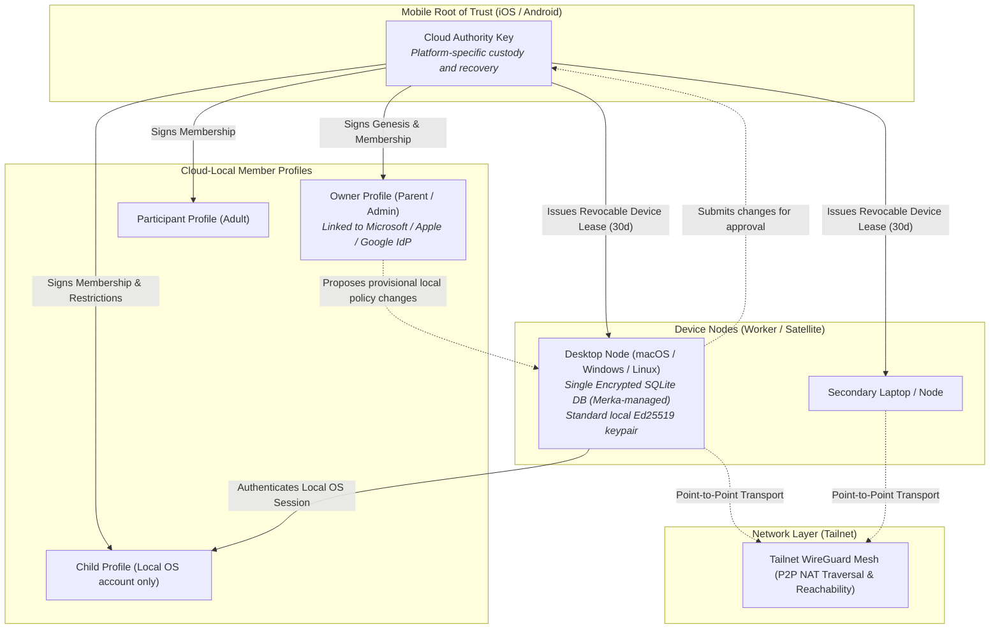

# Merka.cloud Security Architecture

- **Status:** Core design under revision; implementation in progress.
- **Scope:** Cloud creation, mobile root of trust, leased device credentials, encrypted desktop storage, signed cloud-local member profiles, provisional desktop policy changes and mobile-approved synchronization, device removal and recovery, and Tailnet network boundaries.

This document establishes the security architecture for Merka.cloud. The portal is a public cryptographic discovery directory, not an account provider: cloud creation and administration do not require signing in to merka.cloud. Tailnet provides the encrypted network transport and peer reachability layer, while each Merka cloud defines its own cryptographic trust chain, member profiles, device enrollment leases, and data authorization.

---

## 1. Security Principles

- **Intelligent overlay, not file encryptor:** Data files remain in their native locations on their host devices and are governed by native OS filesystem permissions and access control lists. Merka does not replicate or re-encrypt user data files; it operates as an intelligent indexing, metadata, and capability overlay.
- **Mobile device as root of trust:** Cloud creation and top-level administrative authority are anchored in iOS and Android devices, with hardware-backed keys and user authentication where supported and validated.
- **Leased device credentials (TPM-free):** Desktops and worker nodes do not require hardware TPMs or OS-native keychains. They generate local standard keypairs and receive time-bound, revocable **Device Leases** signed by the mobile Cloud Authority. Revocation is effective on each peer when that peer receives and verifies it; leases also expire.
- **Application-managed encrypted storage on desktop:** Desktop nodes do not assume the presence or reliability of OS-native credential vaults (macOS Keychain, Windows DPAPI, or Linux Secret Service), ensuring compatibility across older OSes and minimal Linux distros. Instead, Merka manages its own encrypted storage using a single encrypted SQLite database (e.g., SQLCipher / AES-256-GCM) for sensitive configuration, credentials, and index caches.
- **Local-first desktop administration:** An authenticated Owner can make a provisional security change on an enrolled desktop without waiting for the root phone. The change applies only to activity on that desktop; cloud-wide policy requires explicit root-phone approval.
- **Signed profiles and trust boundaries:** Local databases and CRDT documents are untrusted caches. Cloud-wide profile roles, capabilities, and restrictions require authorized signatures. Signatures protect honest peers from accepting tampered assertions, but cannot secure a compromised device against its own administrator.
- **Signed policy synchronization:** Yjs carries proposals and approved policy records, but is not an authorization authority. Each node verifies the root-phone approval and its policy history before applying a cloud-wide change.
- **Flexible profile mapping (including local-only accounts):** Merka profiles can link to external identities (Apple, Google, Microsoft) or exist purely as local OS accounts (e.g., a child profile on a shared desktop without an email or Tailnet identity).

---

## 2. Identity & Trust Model



### 2.1. Trust Hierarchy Summary

| Identity | Security Primitive | Where Stored | Role & Authority |
| --- | --- | --- | --- |
| **Cloud Authority (Anchor)** | Authority signing key; `cloudId` identifies the genesis authority | Mobile key custody and recovery mechanism to be validated per platform | Signs genesis, approves cloud-wide policy and device leases, handles recovery, publishes discovery records |
| **Member Profile** | Cryptographically signed profile assertion & public key | Synced across nodes via Yjs CRDT; verified locally | Represents a human user (Owner, Participant). May link to Apple/Google/MS IdP or be local-only |
| **Device Node Key** | Ed25519 Keypair | Stored inside Merka's encrypted SQLite database on desktop | Authenticates node-to-node RPC and queries. Held by desktop Tauri/Bun processes |
| **Device Lease** | Compact signed JWS / token | Stored inside encrypted SQLite database | Time-limited certificate issued by Cloud Authority binding Device Key to Cloud and permissions |
| **Tailnet Identity** | Tailscale machine key & user identity | Managed by Tailscale daemon | Network routing, WireGuard transport encryption, and peer reachability |

---

## 3. Leased Device Credentials & Desktop Storage

Desktops (macOS, Windows, Linux) vary widely in their hardware security capabilities. DIY PCs and Linux servers frequently lack standardized, accessible TPM APIs or functional OS keychains.

### 3.1. Single Encrypted SQLite Store (Merka-Managed)
Rather than relying on brittle OS-native credential vaults, Merka on desktop maintains a **single encrypted SQLite database** (e.g., SQLCipher / AES-256-GCM envelope):
- **Contents:** Device keys, active leases, signed profile assertions, Yjs sync state, vector embeddings, and local metadata caches.
- **Keying & Unlock:**
  - During initial device enrollment, the mobile pairing exchange generates and delivers a Database Encryption Key (DEK).
  - The desktop can protect this DEK in memory during active daemon lifecycle, and persist it locally sealed with a lightweight user PIN or session passkey.
  - Zero dependencies on external OS services like `libsecret`, DPAPI, or TPM chips.

### 3.2. Device Enrollment
1. **Join Tailnet:** Before a device is attached to a Merka cloud, the Owner adds it to the cloud's Tailnet. Tailnet membership alone does not enroll the device in Merka or authorize its users.
2. **Key Generation:** When `apps/desktop` is installed, it initializes its encrypted SQLite database and generates a standard local Ed25519 keypair.
3. **Pairing Request:** The desktop displays an enrollment QR code containing its public key, local device name, and Tailnet node identifier. The pairing exchange must verify the live Tailnet node identity and prove possession of the Merka device key, binding both to the same pairing session; the identifier in the QR code alone is not proof.
4. **Approval & Leasing:** The root phone verifies that the node is on the intended Tailnet and matches the pairing request. If verification is unavailable or fails, enrollment remains pending and the Owner is notified. After the Owner confirms the verified device and authenticates, the mobile Cloud Authority signs a **Device Lease**:
   ```json
   {
     "type": "merka.device.lease.v1",
     "cloudId": "urn:merka:cloud:...",
     "devicePublicKey": "...",
     "nodeName": "Living-Room-PC",
     "tailnetNodeId": "node-xyz",
     "issuedAt": 1731110000,
     "expiresAt": 1733702000,
     "capabilities": ["index.read", "search.execute", "inference.host"]
   }
   ```
5. **Lease Delivery:** The signed lease and initial cloud configuration are returned to the desktop and stored in its encrypted SQLite database. This sequence also applies to other devices attached to the cloud, including additional phones.

### 3.3. Lease Renewal & Revocation
- **Renewal:** Before issuing a new lease, the mobile authority verifies that the device is not Merka-revoked and that the requesting device still matches the enrolled Tailnet node on the intended Tailnet. A mismatch or unavailable verification prevents renewal and is shown to the Owner; it does not by itself revoke the existing lease or interrupt ordinary local activity. Background availability and silent signing on mobile are platform-dependent and must not be assumed.
- **Removal:** For a lost, sold, or compromised device, the Owner selects **"Revoke Device"** on the root phone. The authority signs a revocation of the device key and its leases and publishes it in the cloud policy log. Once each peer verifies the record, it drops existing connections, rejects new requests and proposals from that device, and does not renew its credentials. Merka revocation must not wait for Tailnet verification or removal.
- **Tailnet follow-up:** Removing a device from Merka does not remove it from Tailnet. Prompt the Owner to remove or restrict its Tailnet access as soon as possible, especially for a compromised device. Where an authorized, reliable Tailnet status source is available, check whether removal or restriction is complete and show the result. Otherwise keep the follow-up visibly unverified and ask the Owner to check in Tailscale; do not report removal as verified merely because the device is offline or unreachable. Notification delivery may be delayed while the phone is unavailable, so retain the outstanding action for the next app session.
- **Tailnet changes:** If Merka learns from an authorized, reliable source that an enrolled node was removed from the Tailnet or no longer matches its enrolled identity, notify the Owner and prevent lease renewal. Prompt the Owner to review and revoke its Merka lease if appropriate; Tailnet removal alone is not a signed Merka revocation. An offline node or a failed lookup is an unknown status, not proof of removal.
- **Offline limitation:** Peers that have not received the revocation can continue to accept an otherwise valid lease until they learn of the revocation or the lease expires. A compromised device cannot be relied on to erase its keys or enforce expiration locally. Merka cannot recall data already obtained by that device.
- **Containment and recovery:** Section 6.4 describes how to assess authority-key rotation and reissue credentials to the remaining devices after a suspected compromise.

---

## 4. Member Profiles, Local Accounts & Tamper-Proofing

Merka separates the **device lease** (which trusts the physical machine) from the **member profile** (which governs who is acting).

### 4.1. Account Types Supported
1. **Federated / Social Identity Profiles:**
   - Member profiles linked to an Apple ID, Google Account, or Microsoft Account.
   - Useful for adult family members who have their own personal devices and email addresses.
2. **Local-Only OS Profiles (e.g., Children, Family Shared Accounts):**
   - A member profile with no email, no cloud account, and no Tailnet identity.
   - Example: A child with a local login account on a family macOS or Windows computer.
   - **How Trust is Established:**
     - The parent authorizes the desktop computer via a Device Lease.
     - Within the desktop app, the parent provisions a child profile mapped to the local OS user session (POSIX UID on macOS/Linux or Windows SID).
     - Local Bun agent processes run under the child's OS account, inheriting normal OS file isolation.
     - The child's agent can participate in cloud queries only within cloud-approved bounds; remote nodes independently verify the applicable member authorization and device lease.

### 4.2. Tamper-Proofing Against Local Privilege Escalation
On a shared desktop, a local user might attempt to elevate their privileges by modifying SQLite rows or cached JSON/CRDT files. On an uncompromised node, Merka uses two defense layers:

1. **Database Encryption at Rest:**
   - The Merka SQLite store is encrypted at rest using AES-256. Unprivileged OS accounts on the machine cannot read or write the database file directly.
2. **Cryptographic Signatures as Source of Truth:**
   - Editing a cached assertion (e.g., setting `"role": "Owner"`) does not produce a valid cloud-approved assertion.
   - Each cloud-wide profile role, capability grant, and content boundary is encapsulated in a **Profile Assertion** authorized by the Cloud Authority:
     ```json
     {
       "type": "merka.profile.assertion.v1",
       "cloudId": "urn:merka:cloud:...",
       "profileId": "profile-child-1",
       "role": "Participant",
       "restrictions": {
         "allowedSearchScopes": ["library:school", "folder:family-photos"],
         "maxInferenceTokensPerHour": 5000
       },
       "policyVersion": 4,
       "signer": "authorized-signer-pubkey",
       "signature": "..."
     }
     ```
   - **Verification on Every Query:** When a child's agent requests a Scatter-Gather search or file access, the responding node evaluates the cloud-approved assertion. Altered assertions without valid authorization are rejected. A provisional local overlay is not a cloud-approved assertion.

A compromised desktop or OS administrator can alter local software and observe or use data accessible there. Signatures do not prevent this; they limit what honest peers will accept from that device.

---

## 5. Provisional Desktop Changes & Mobile-Approved Synchronization

The Owner can change security scopes on an enrolled desktop even while the root phone is unavailable. The change is provisional and local until the root phone explicitly approves the exact change for the cloud. This applies to every desktop-originated cloud-wide security policy change, including both grants and restrictions.

```mermaid
sequenceDiagram
    autonumber
    actor Owner as Owner (at Desktop)
    participant Desktop as Desktop (Tauri UI & Agent)
    participant Yjs as Yjs transport (Tailnet WS)
    participant Phone as Root Phone
    participant Remote as Remote Merka Nodes

    Note over Owner,Desktop: Owner edits child's search scopes on Desktop
    Desktop->>Desktop: Authenticate Owner and apply local provisional overlay
    Desktop->>Yjs: Queue signed proposal when connected
    Note over Desktop,Phone: Phone may be offline; local activity continues
    Yjs->>Phone: Deliver pending proposal when reachable
    Phone->>Owner: Show exact change and request approval
    Owner->>Phone: Approve or reject
    Phone->>Yjs: Publish signed decision
    Yjs->>Desktop: Deliver decision
    alt Approved
        Yjs->>Remote: Deliver approved policy record
        Note over Remote: Verify authority and policy history before applying
    else Rejected
        Note over Desktop: Remove corresponding local overlay on receipt
    end
```

### 5.1. Local Proposals
- The desktop checks its locally verifiable lease and authenticates the Owner using the approved local session or credential policy. An offline change cannot depend on a live Tailnet or IdP connection; offline authentication, freshness limits, and expired-lease behavior remain to be specified. A device lease or Tailnet presence alone is not Owner authentication.
- A proposal records the cloud and profile, originating device and Owner, exact old and new values, base approved policy identifier, and a unique proposal identifier. It is signed by the device and persisted with its pending status for delivery when connectivity returns. It is not itself a cloud authorization.
- Apply the provisional overlay only to operations performed locally on that desktop. A provisional grant must not authorize remote requests to or from the desktop, or grant access to data on another node. Remote authorization uses cloud-approved policy; the originating desktop also enforces its provisional local restrictions on outgoing operations. OS permissions remain a lower bound for local access.
- Show the pending state and local-only scope clearly. If the phone is unavailable, keep the overlay and queued proposal until an explicit decision or a separately specified expiration/cancellation rule. Ordinary local activity need not wait for a phone response.
- Local restrictions take effect on the desktop immediately, but do not revoke access on other devices until approved and delivered there. A provisional grant may already have exposed local data; rejection cannot undo that exposure.

### 5.2. Approval and Peer Verification
- When reachable, the root phone displays the source, affected profiles and scopes, and exact before/after change. After Owner confirmation and required device authentication, it signs an approval or rejection bound to the proposal identifier, exact change and base policy. Receiving a proposal or a push notification is not approval.
- Before approval, the phone checks the proposal's signature, device lease and revocation status, Owner authorization evidence, and base policy. The exact authentication evidence and validation rules need a protocol specification; an IdP login alone is not proof that the phone approved a particular change.
- A signed approval creates a cloud policy record. Each peer, including the proposing desktop, verifies the authority chain, exact approved content, and applicable predecessor before applying it. Once the proposing desktop applies the record, it removes the corresponding provisional overlay while preserving independent pending changes. A higher version number or a CRDT merge alone is insufficient. Peers that have not received the approval continue using their last approved policy.
- If the base policy has changed or concurrent proposals conflict, do not silently merge or replay an approval against a different state. Rebase or resolve the proposal and obtain a new approval for the resulting exact change. Peers must not replace a newer accepted policy with an older one.
- On rejection, the originating desktop removes the corresponding provisional overlay when it receives the decision and returns to the applicable approved policy, preserving other independent pending changes. Record the decision and notify the Owner. A compromised or offline desktop may not comply immediately; it must not be trusted to enforce the decision locally.

### 5.3. Other Mobile Authority Operations
The root phone also authorizes cloud genesis, device enrollment and removal, authority handover, and recovery. These cloud-level operations cannot be performed through a provisional desktop overlay. A phone can sign a security change initiated directly on that phone after Owner confirmation; it does not need to approve its own change a second time.

---

## 6. Mobile Key Custody & Device Recovery

Because the mobile device serves as the primary Cloud Authority, handling device upgrades (Scenario A) and device loss (Scenario B) is essential.

### 6.1. Hardware Enclave Storage
The desired design uses platform hardware-backed keys and user authentication where supported. The signing algorithm, hardware generation, biometric policy, backup, and restoration capabilities must be validated separately on iOS and Android. A non-exportable hardware key cannot simply be assumed to synchronize or be restored into a new enclave; the recovery design must explicitly account for that distinction.

### 6.2. Scenario A: Planned Device Upgrade (Phone A $\to$ Phone B)
When the user purchases a new phone and both the old and new devices are operational:
1. **Key Generation:** Phone B joins the intended Tailnet before being attached to the cloud. Merka is installed on Phone B, generating a new platform-supported authority keypair (`PhoneB_PubKey`); pairing verifies its Tailnet identity and binds it to proof of possession of the new key as in section 3.2.
2. **Pairing Session:** Phone B generates a high-entropy ephemeral pairing QR code.
3. **Biometric Authorization:** Phone A scans the QR code. The user authenticates via FaceID/fingerprint.
4. **Handover Certificate:** Phone A signs a **Cloud Authority Handover Record**:
   ```json
   {
     "type": "merka.authority.handover.v1",
     "cloudId": "urn:merka:cloud:...",
     "oldAuthority": "PhoneA_PubKey",
     "newAuthority": "PhoneB_PubKey",
     "transferredAt": 1731110000,
     "signature": "..."
   }
   ```
5. **Propagation & Portal Update:**
   - Phone B broadcasts the handover record to all enrolled nodes over the Tailnet mesh.
   - Phone B publishes an authenticated update to the public discovery portal signed by the handover chain.
   - The `cloudId` remains the genesis identity; the verified handover chain identifies the current authority. Phone A removes its authority credentials and transitions to an ordinary participant or is decommissioned.

### 6.3. Scenario B: Sudden Loss / Destruction Recovery
If Phone A is lost or destroyed, a replacement must establish authority through a separately designed recovery mechanism. Platform backup may be considered for recoverable key material, but the availability, protection, and restoration of that material cannot be assumed. The mechanism must preserve or securely re-establish the genesis `cloudId`, authorize a new phone key, and revoke the lost phone; it must not depend on importing a non-exportable key into a new enclave. Until that mechanism is specified and validated, loss of the only authority key can make cloud administration unrecoverable.

### 6.4. Scenario C: Compromised Desktop and Authority Rotation
1. **Contain:** Revoke the desktop as in section 3.3. Reject its pending proposals rather than approving them. Inspect recent approved security actions and other credentials or data the device could access. Remove its Tailnet access separately.
2. **Assess authority exposure:** A desktop compromise alone does not mean the phone's authority key was exposed; desktop leases are not authority keys. If the Owner wants precautionary rotation and the current phone authority remains trusted, generate a new phone authority key and sign a handover to it using the current key. Maintain the genesis `cloudId`, distribute the verified transition and update the discovery record. Peers accept the new authority only through the verified transition, not merely because the desktop or portal presents a new key.
3. **Reissue remaining credentials:** The new authority revokes or supersedes old leases, then issues new time-limited leases only to verified, non-compromised devices after the Tailnet checks in section 3.3. Re-enrollment or new device keypairs may be needed where device-key exposure is suspected. Bind leases to the current authority or credential epoch so updated peers reject superseded credentials; do not renew or reissue credentials for the removed device. Rotate other exposed secrets separately as appropriate.
4. **Account for offline peers:** Notify devices to synchronize the revocation and authority transition before accepting replacement leases. A peer that has not received the transition may continue accepting previously valid credentials until expiry; an offline device may be unable to use cloud services until it reconnects and receives a new lease. Normal local activity under its last approved policy need not wait, subject to the offline security policy.

If the current authority key itself may be compromised, a transition signed only by that key cannot distinguish the Owner from an attacker. Use an independently authorized recovery process; that process is not yet specified. Rotation and lease reissuance cannot undo prior access or guarantee immediate isolation from offline peers.

---

## 7. Tailnet Role & Separation of Concerns

Tailnet provides essential networking infrastructure, but is strictly isolated from application authorization:

```mermaid
graph LR
    subgraph NetworkLayer["Transport Layer (Tailnet / WireGuard)"]
        direction TB
        NL1["NAT Traversal & Hole Punching"]
        NL2["Point-to-Point WireGuard Encryption"]
        NL3["Network Peer Reachability & Stable IPs"]
        NL4["tailscale whois (Machine / Node verification)"]
    end

    subgraph AppLayer["Application Layer (Merka Trust Chain)"]
        direction TB
        AL1["Cloud Authority Signing & Leases"]
        AL2["Member Profiles (Parents, Kids, Local Users)"]
        AL3["CRDT State Sync & Vector Query Authorization"]
        AL4["Local OS File Access (Native Permissions)"]
    end

    NetworkLayer -->|"Carries Encrypted Packets"| AppLayer
```



- **WireGuard handles transit security:** Prevents eavesdropping, tampering, and public IP exposure across the WAN.
- **Merka handles data authorization:** Enforces member grants and child restrictions on uncompromised nodes. Peers that have received a valid revocation reject the device even if it remains connected to the Tailnet.

---

## 8. Open Decisions Before Implementation

1. **Lease Format Specification:** Finalize the compact JWS claims and schema for device leases in `@merka/core`.
2. **Renewal Interval:** Determine default lease duration (e.g., 14 days vs. 30 days) and silent renewal frequency over Tailnet.
3. **Local Child Consent & Audit:** Define the UI flow in Tauri 2 for parents to review and set search boundaries for local-only child accounts on shared machines.
4. **Portal Discovery Record Rotation:** Specify the signed transition record format when the Cloud Authority is rotated following a device handover.
5. **Offline Proposals:** Specify offline Owner authentication, lease freshness, provisional-overlay persistence and cancellation, and conflict resolution without permitting unapproved remote access.
6. **Approval and Recovery Protocols:** Define exact signed proposal/decision and policy-history formats, credential epochs, independent recovery from authority compromise, and platform-specific key custody and backup guarantees.
7. **Offline Revocation:** Choose freshness and expiry rules that balance local availability with the maximum time an isolated peer may accept stale credentials.
8. **Tailnet Verification:** Specify the authenticated pairing and renewal checks, the authorized status sources and their required permissions, and how to notify the Owner when status cannot be verified without assuming that offline means removed.
